# TimesNet: Reproduction and Enhancements

This repository reproduces the results of **TimesNet: Temporal 2D-Variation Modeling for General Time Series Analysis** (Wu et al., ICLR 2023) using the [Time-Series-Library (TSLib)](https://github.com/thuml/Time-Series-Library), fixes the data-leakage and preprocessing issues we found, and tests several enhancements, including **TimesNet-KANB** (TimesNet with a trainable KANB activation in place of GELU).

| Task | Paper table | Datasets | Author | Student ID |
|---|---|---|---|---|
| Long-term forecasting | Table 13 | ETTh1, ETTh2, Exchange, ILI, Weather | *Rohan Manro* | 26112034 |
| Short-term forecasting | Table 14 | M4 (Yearly, Quarterly, Monthly, Weekly, Daily, Hourly) | *Sarthak Agarwal* | 26115627 |
| Classification | Table 17 | EthanolConcentration, Handwriting, JapaneseVowels, SelfRegulationSCP1, SelfRegulationSCP2, UWaveGestureLibrary | *Iakovos-Christos Zarkadis* | 26110104 |

---

## Table of contents
1. [Repository contents](#1-repository-contents)
2. [Environment setup](#2-environment-setup)
3. [Data download](#3-data-download)
4. [Reproducing the results](#4-reproducing-the-results)
5. [Results](#5-results)
6. [Additional results and files](#6-additional-results-and-files)

---

## 1. Repository contents

```
TimesNet_Enhancements/
├── Replication_&_Enhancement_Files.zip    # all notebooks (unzip first)
│   ├── TimesNet_Table13_Long_Term_Forecasting.ipynb
│   ├── TimesNet_Table14_Short_Term_Forecasting.ipynb
│   ├── Classification_Ours_TimesNet_EthanolConcentration.ipynb
│   ├── Classification_Ours_TimesNet_Handwriting.ipynb
│   ├── Classification_Ours_TimesNet_JapaneseVowels.ipynb
│   ├── Classification_Ours_TimesNet_SelfRegulationSCP1.ipynb
│   ├── Classification_Ours_TimesNet_SelfRegulationSCP2.ipynb
│   └── Classification_Ours_TimesNet_UWaveGestureLibrary.ipynb
├── table_images/                          # result tables shown below
└── README.md
```

Each notebook is **self-contained**: wrapper functions inside the notebook set up the environment, clone TSLib at a fixed commit, download the data, apply our fixes, train the models and build the result tables. No local installation is needed.

---

## 2. Environment setup

The notebooks are designed for **Google Colab**.

1. **Unzip** `Replication_&_Enhancement_Files.zip` and upload the notebook you want to run to Colab (**File → Upload notebook**).
2. **Choose the runtime:** **Runtime → Change runtime type**
   - **GPU:** **L4 or higher** (e.g. A100). Smaller GPUs are too slow or run out of memory.
   - **High-RAM:** **on**. Several datasets (e.g. M4, Weather, UEA) are too large for the standard RAM setting.
3. **Allow Google Drive access** when the first cell asks for it. All checkpoints, logs and intermediate results are saved to Drive, so:
   - a crash or a Colab disconnect does not lose any work;
   - finished runs are **skipped automatically** when you run a cell again, so you can continue where you stopped.

The notebook then creates its own isolated environment automatically. Key versions:

| Component | Version |
|---|---|
| TSLib | commit `4e938a1` (pinned) |
| Python | 3.11 |
| PyTorch | 2.5.1 (CUDA 12.1); 2.7.1 (CUDA 12.8) on newer GPUs |
| NumPy / pandas | 2.1.2 / 2.3.3 |
| Other | `sktime`, `patool`, `scikit-learn`, `shap`, `plotly` (installed by the notebooks) |

For reproducibility, the notebooks also fix all random seeds, turn on deterministic GPU kernels and **turn off TF32**: the paper used an NVIDIA TITAN RTX, which has no TF32.

---

## 3. Data download

**Nothing to do manually.** Section 2 of every notebook downloads the datasets used in the paper and stores them in the Colab session:

| Notebook | Data downloaded |
|---|---|
| Long-term (Table 13) | ETT (h1, h2, m1, m2), Exchange, ILI, Weather, Electricity, Traffic |
| Short-term (Table 14) | M4 |
| Classification (Table 17) | The UEA dataset of that notebook |

---

## 4. Reproducing the results

Open the notebook and run the sections **in order**, starting with Sections 1 and 2 (setup) in every new Colab session. Results are written to `MyDrive/TimesNet_reproduction/` on your Google Drive.

### Long-term forecasting: `TimesNet_Table13_Long_Term_Forecasting.ipynb` (Rohan Manro)

| Result | Sections to run |
|---|---|
| Setup (every session) | 1, 2, 2.1, 3, 4 |
| Reproduction of Table 13 (3 seeds) | 5 (one cell per dataset), then 7 (comparison with the paper) |
| Determinism check | 8 |
| Weather cleaning (−9999 placeholders), fair comparison | 9 |
| Model stability under input noise | 10 (uses the models from Section 5, no training) |
| SHAP explanations (ETTh1, ETTh2) | 11 (uses the models from Section 5, no training) |
| Learning-rate schedules (cosine, plateau vs halving) | 12 |
| TimesNet vs TimesNet-KANB, explainability and drift | 13 |

### Short-term forecasting: `TimesNet_Table14_Short_Term_Forecasting.ipynb` (Sarthak Agarwal)

| Result | Sections to run |
|---|---|
| Setup (every session) | 1, 2 |
| Data-leakage fix (validation split) | 2b |
| Preprocessing fix and outlier check | 2c, 2d |
| Reproduction of Table 14 (3 seeds) | 3, 4, 5, then 6 (comparison) and 6b (effect of each fix) |
| Determinism check | 7 |
| TimesNet vs TimesNet-KANB on M4 | 8 |

### Classification: `Classification_Ours_TimesNet_<Dataset>.ipynb` (Iakovos-Christos Zarkadis)

One notebook per dataset, all with the same structure:

| Result | Sections to run |
|---|---|
| Setup (every session) | 1, 2, 3 |
| Leak-free 10-fold CV with TimesNet and TimesNet-KANB | 4, 5, 6, 7, 8 |
| Comparison with the paper and other models | 9, 9b, 9c, 9d |
| Explainability (channel ablation, SHAP, KANB parameters) | 10, 10a-10d |
| Determinism check | 11 |
| Download all results as one zip | 12 |

> **Tip:** run one section at a time instead of *Runtime → Run all*. Training cells can take several hours, and finished runs are skipped when a cell is run again.

---

## 5. Results

### Detailed tables

#### Long-term forecasting (Table 13)
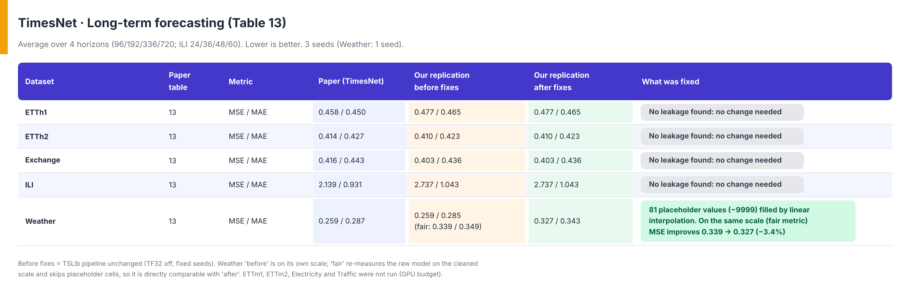
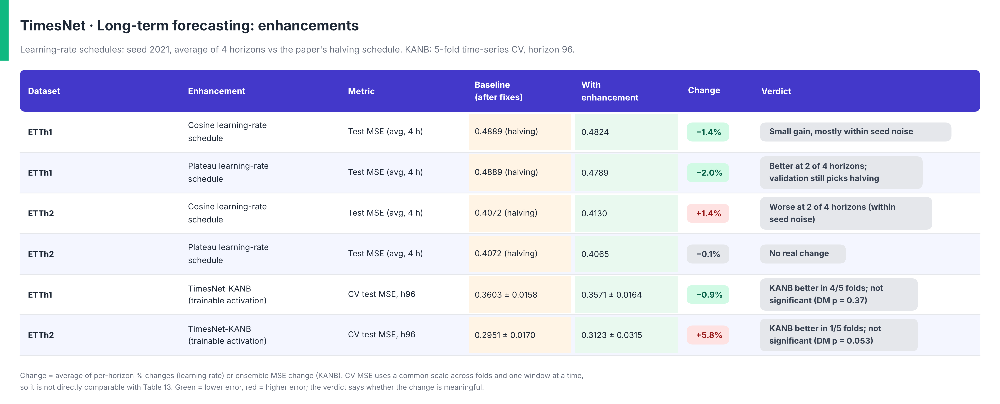

#### Short-term forecasting (Table 14)
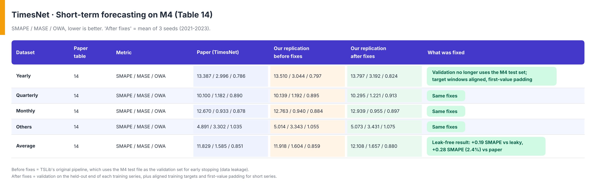
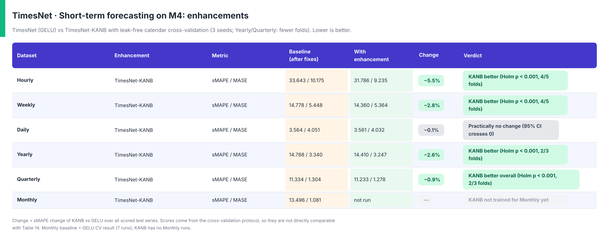

#### Classification (Table 17)
<details>
<summary><b>EthanolConcentration</b></summary>

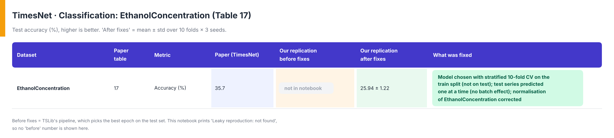

</details>

<details>
<summary><b>Handwriting</b></summary>

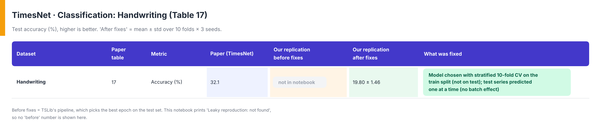
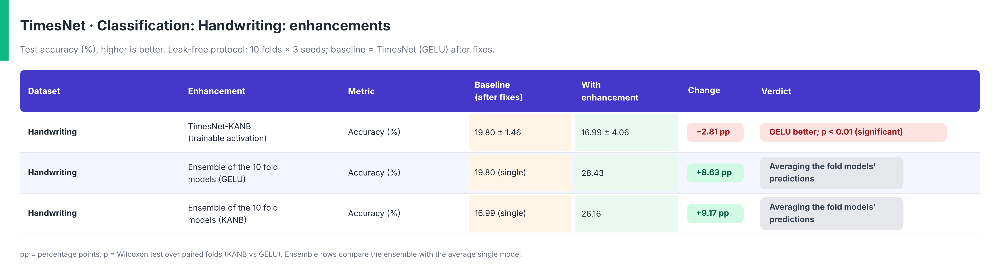
</details>

<details>
<summary><b>JapaneseVowels</b></summary>

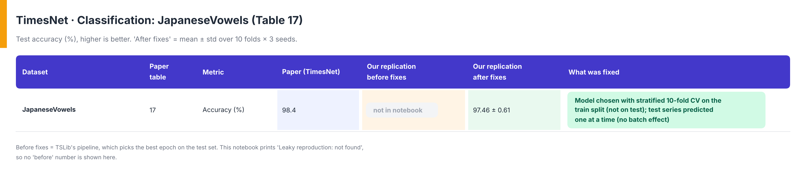
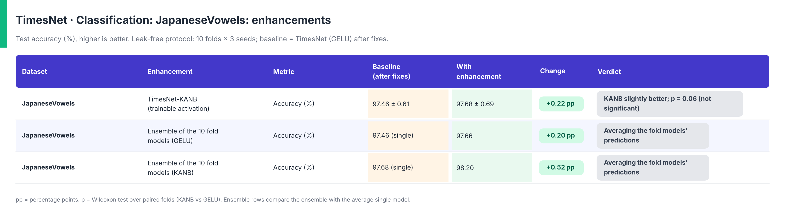
</details>

<details>
<summary><b>SelfRegulationSCP1</b></summary>


</details>

<details>
<summary><b>SelfRegulationSCP2</b></summary>


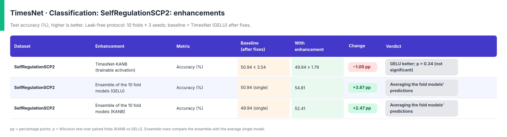
</details>

<details>
<summary><b>UWaveGestureLibrary</b></summary>


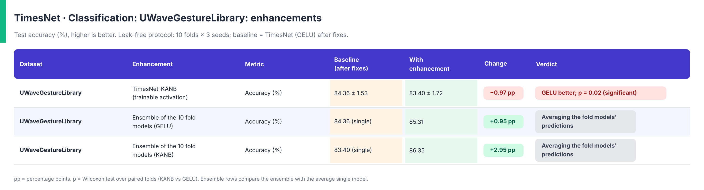
</details>

---

## 6. Additional results and files

All other outputs generated during our runs (trained checkpoints, logs, per-run results, SHAP explanations, plots and reports) are available on Google Drive:

**[Google Drive: additional results and files](https://drive.google.com/drive/folders/1v4l0qu6_IRFZRV9e5wOgzcC72o9HCMBJ?usp=sharing)**

---

## References
- H. Wu, T. Hu, Y. Liu, H. Zhou, J. Wang, M. Long. *TimesNet: Temporal 2D-Variation Modeling for General Time Series Analysis.* ICLR 2023. [arXiv:2210.02186](https://arxiv.org/abs/2210.02186)
- Time-Series-Library (TSLib): https://github.com/thuml/Time-Series-Library
